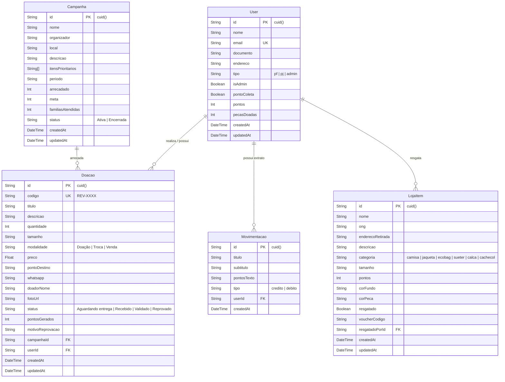

# Diagrama de Entidade e Relacionamento (DER) - ReVeste

Este documento descreve o modelo conceitual e relacional do banco de dados do projeto **ReVeste** (PostgreSQL no Supabase via Prisma ORM).

---

## 📊 Diagrama Visual (Mermaid)

---

## 🔗 Descrição dos Relacionamentos

1. **`User` ➔ `Doacao` (1:N)**: Um usuário pode cadastrar múltiplas doações. Uma doação pertence a um usuário (ou é anônima).
2. **`Campanha` ➔ `Doacao` (1:N)**: Uma campanha comunitária pode agrupar várias doações vinculadas a ela.
3. **`User` ➔ `LojaItem` (1:N)**: Um usuário pode resgatar itens na loja solidária usando seus pontos acumulados (`resgatadoPorId`).
4. **`User` ➔ `Movimentacao` (1:N)**: O histórico de pontos de cada usuário registra transações de crédito (ao doar) e débito (ao resgatar).
